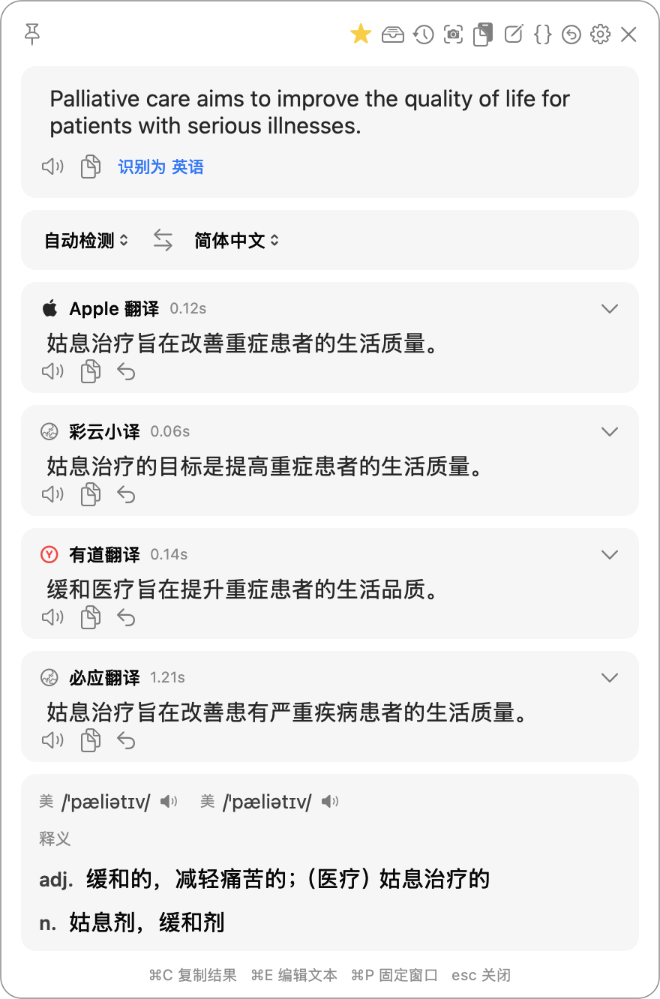
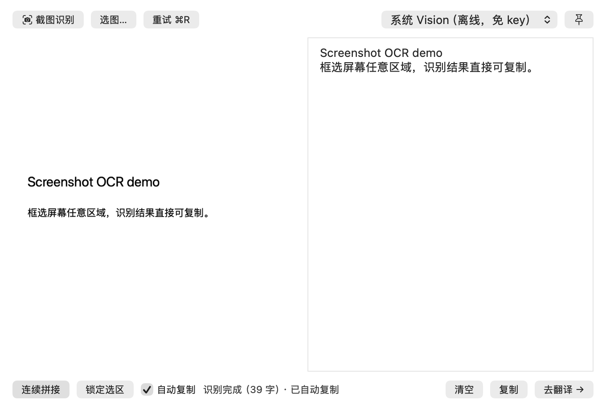
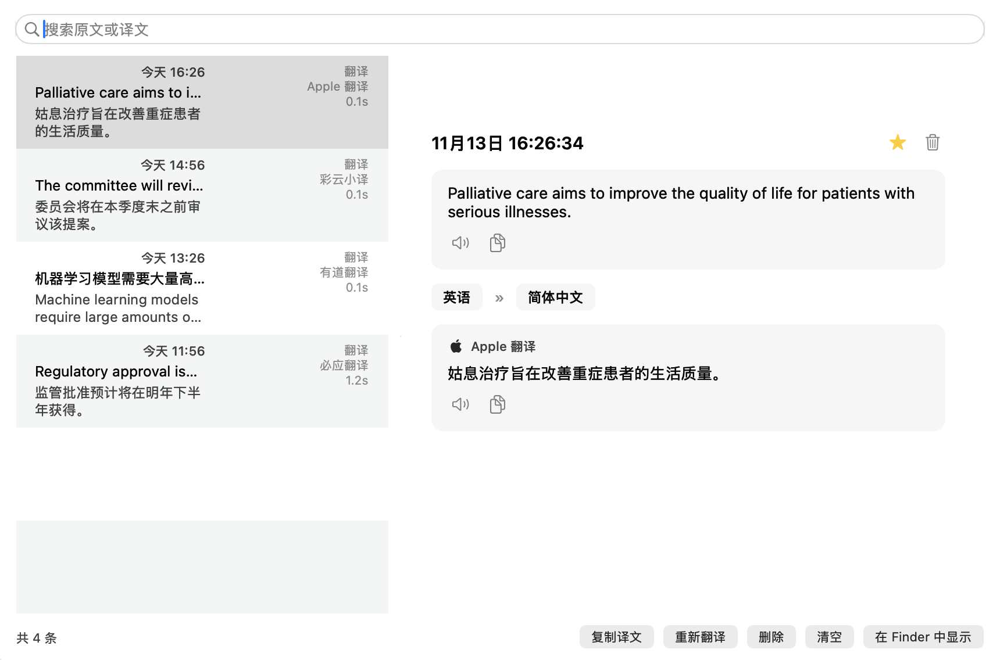
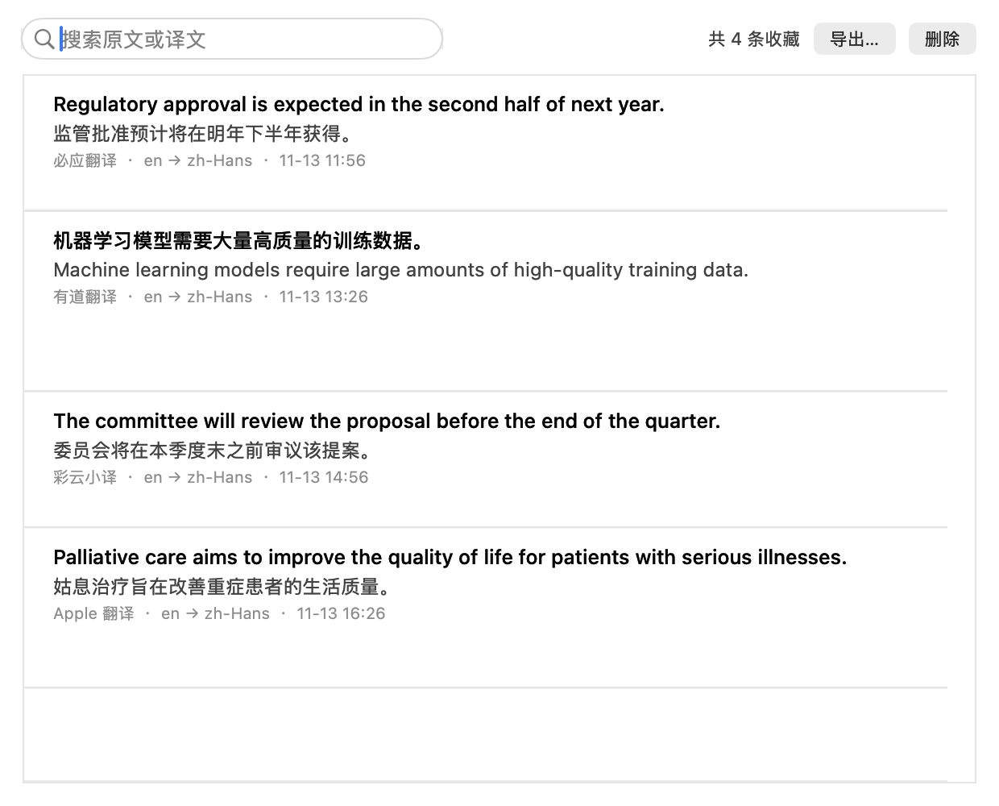
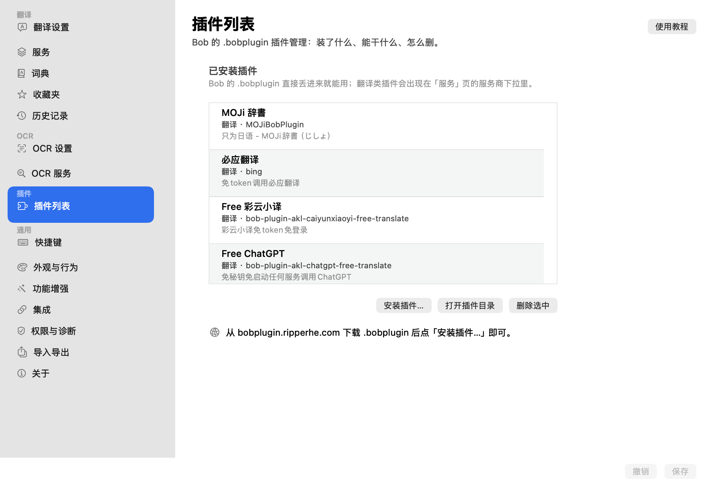
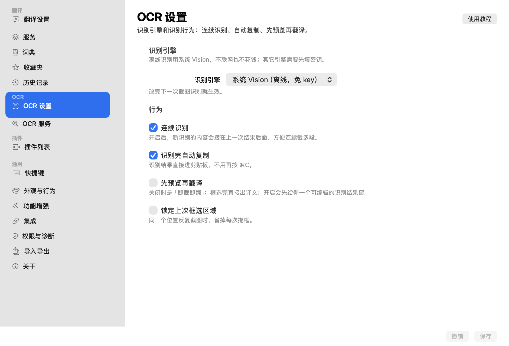

# LocalTranslate

macOS 上的划词翻译工具。选中文字，按一下快捷键，光标旁边就出译文；也可以截图翻译、输入翻译、查词典。

纯 Swift + AppKit 写的，没有 Electron，没有第三方依赖，装完就是一个 `.app`。



<p>


</p>

界面和交互是照着 [Bob](https://bobtranslate.com) 做的——因为 Bob 好用，但它只有 macOS，我想把同类功能用原生重写一遍，顺便把免费引擎这条线做扎实。翻译服务的接入方式参考了 [nextai-translator](https://github.com/nextai-translator/nextai-translator)。

## 功能

**翻译**

- 划词翻译：选中文字按快捷键，浮窗显示译文，多家引擎并排对比
- 截图翻译：框选屏幕区域，OCR 后翻译
- 输入翻译：开一个输入框，敲回车翻译
- 剪贴板翻译：直接翻译剪贴板里的内容
- 静默翻译并复制：不弹窗，译文直接进剪贴板
- 静默划词替换：选中一段话，原地替换成译文（Word、浏览器都测过）

**OCR**

- 截图 OCR、静默截图 OCR（识别结果直接进剪贴板）
- 访达选图 OCR：在访达选中图片后按快捷键，或者把图片拖到 App 图标上
- 二维码识别：截图或图片里有二维码会一起读出来
- 智能分段：按行高和缩进把识别结果还原成段落

**词典**

- 选中的是单词或词组时，浮窗底部多一块词典区
- 多个离线/免密钥来源依次兜底：ECDict → 系统词典 → MOJi（日语）→ 有道词典 → 剑桥词典
- 音标、词性、释义、例句、词形变化

**其它**

- 历史记录、收藏夹（都内嵌在设置窗口里）
- 语音朗读（系统语音 / Edge TTS / 微软 / 谷歌 / 腾讯等）
- 插件：兼容 Bob 的 `.bobplugin`，双击安装，装完可以一键加成翻译服务
- 浏览器助手：本地起一个 127.0.0.1 的小服务 + 一个 Chromium 扩展，网页里选中文字点「译」就地显示译文
- PopClip 扩展、URL Scheme、AppleScript 调用

## 界面

**翻译浮窗**：原文卡片、语言栏、每家引擎一张卡片，下面是并排的词典区。


**OCR 工作台**：左边是截取的图片，右边是识别结果，可以直接编辑、复制或送去翻译。



**历史记录**：左边列表，右边详情，可以重翻、收藏、删除。



**收藏夹**：搜索、复制、导出 Anki/CSV/JSON。



**设置 · 插件列表**：Bob 的 `.bobplugin` 双击安装，装完可以直接加成翻译服务。



**设置 · OCR**：识别引擎和识别行为。



## 免密钥就能用的引擎

默认开箱可用，不用注册、不用填 Key：

| 引擎 | 类型 | 实测耗时 |
|---|---|---|
| Apple 翻译 | 翻译 | ~0.1s（需要系统装了对应语言包） |
| 彩云小译 | 翻译 | ~0.06s |
| 有道翻译 | 翻译 | ~0.14s |
| 火山翻译 | 翻译 | ~0.23s |
| 必应翻译 | 翻译 | ~1.2s |
| 谷歌翻译 | 翻译 | 受 IP 限流时自动冷却 |
| MyMemory | 翻译 | 同上 |
| ECDict / 系统词典 / MOJi / 有道 / 剑桥 | 词典 | 离线或毫秒级 |

需要密钥的服务（DeepSeek、OpenAI、Claude、Gemini、DeepL、百度、腾讯、微软、Amazon 等）在「设置 → 服务」里添加，共 39 个预设。

## 安装

```bash
./scripts/setup_signing.sh      # 建一把本地签名证书，只做一次
./scripts/build_app.sh          # 编译并打包成 build/LocalTranslate.app
cp -R build/LocalTranslate.app /Applications/
open -a /Applications/LocalTranslate.app
```

第一次运行要给辅助功能权限，否则读不到你选中的文字：**系统设置 → 隐私与安全性 → 辅助功能**，把 LocalTranslate 打开。

用的是本地自签证书，好处是重新编译后授权不会掉；如果用默认 ad-hoc 签名，每次重编都要重新勾一遍。

覆盖安装后如果 `open -a` 报 `-600`，是 LaunchServices 缓存了旧记录：

```bash
/System/Library/Frameworks/CoreServices.framework/Frameworks/LaunchServices.framework/Support/lsregister -f /Applications/LocalTranslate.app
```

## 快捷键

默认都是 `⌃⇧` 开头，可以在设置里改。

| 快捷键 | 作用 |
|---|---|
| `⌃⇧D` | 划词翻译 |
| `⌃⇧S` | 截图翻译 |
| `⌃⇧A` | 输入翻译 |
| `⌃⇧C` | 翻译剪贴板 |
| `⌃⇧K` | 词典 |
| `⌃⇧O` | 静默截图 OCR |
| `⌃⇧Z` | 静默翻译并复制 |
| `⌃⇧E` | 静默划词替换 |
| `⌃⇧R` | 朗读选中文字 |
| `⌃⇧H` | 显示/隐藏菜单栏图标 |

翻译浮窗里的快捷键：`⌘C` 复制译文、`⌘E` 编辑原文、`⌘P` 固定窗口、`⌘S` 收藏、`⌘+/-` 调字号、`esc` 关闭。

## 隐私

- 翻译请求只发给**你自己配置的**服务商，没有中间服务器，没有统计上报
- 历史记录、收藏夹、配置都在 `~/Library/Application Support/LocalTranslate/`，纯本地 JSON
- API Key 优先存系统钥匙串，写不进去才退到本地文件（权限 600）
- 浏览器助手的服务只监听 `127.0.0.1`
- 插件运行在 JavaScriptCore 沙盒里，`$file` 读写限制在插件自己的目录

## 代码结构

更细的模块说明见 [docs/ARCHITECTURE.md](docs/ARCHITECTURE.md)。

```
Sources/LocalTranslate/
├── AppDelegate.swift          # 菜单栏、全局快捷键、各入口的调度
├── TranslationCard.swift      # 翻译浮窗（Bob 风格卡片布局）
├── ScreenOCR.swift            # 截图选区、Vision 识别、分段
├── *Translators.swift         # 各家免密钥引擎（Apple/必应/有道/彩云/火山…）
├── DictionaryService.swift    # 词典查询链路
├── PluginRuntime.swift        # Bob 插件运行时（JSContext + $http/$data/$file…）
├── HelperServer.swift         # 浏览器助手的本地 HTTP 服务
└── SelfTest.swift             # 82 项自检
```

## 开发

```bash
./scripts/verify.sh        # 全套自检：82 项，退出码 0 才算过
```

自检覆盖单元测试、真实网络请求、OCR、插件运行时、界面渲染、真实按键等。失败的项会打印原因，不是"看起来过了"。

截图可以重新生成（离屏渲染，不依赖真实数据）：

```bash
./build/LocalTranslate.app/Contents/MacOS/LocalTranslate --selftest screenshots docs/screenshots
```

## 已知限制

- 谷歌和 MyMemory 的免费接口按 IP 限流，打多了会返回 429。程序会自动冷却 10 分钟，期间由其它引擎顶上
- Apple 翻译需要系统里装好语言包。英文↔中文通常有，其它语向缺包时会自动跳过这一家
- 浏览器助手目前只支持 Chromium 系（Chrome / Edge / Brave）。Safari 扩展需要 Xcode 打包签名，没做
- 原图翻译（把译文画回截图）只做了基础版本，复杂排版会错位

## 参考与致谢

- [Bob](https://bobtranslate.com)：界面与交互的参照对象
- [nextai-translator](https://github.com/nextai-translator/nextai-translator)：服务接入方式
- [bobplugin.ripperhe.com](https://bobplugin.ripperhe.com)：社区插件列表，本项目实测了其中 11 个

## 许可

MIT
